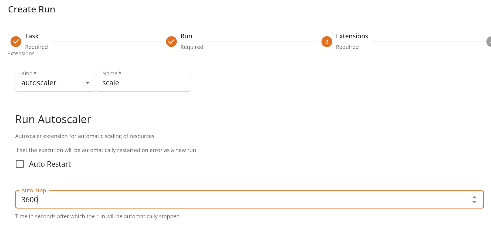

# Run autoscaler

The _autoscaler_ extension can be applied to function executions (_"runs"_) to automatically react to events regarding the specific execution such as :

- `auto_shutdown`: automatically stops the run after a given amount of time
- `auto_restart`: automatically restarts the execution (as a new run) when terminated due to an error

### How to use

In order to leverage the _auto scaler_ append the extension to a run either at the time of creation or while still running.

Via console, set the parameters in the extensions tab of the creation form as in figure.



When using the SDK, include an extension definition while creating or updating the run.

```python

autoscaler =  {
      "kind": "autoscaler",
      "spec": {
        "auto_restart": True
      }
    }

run = function.run(
    action="serve",
    extensions=[autoscaler]
    ...
)


```
