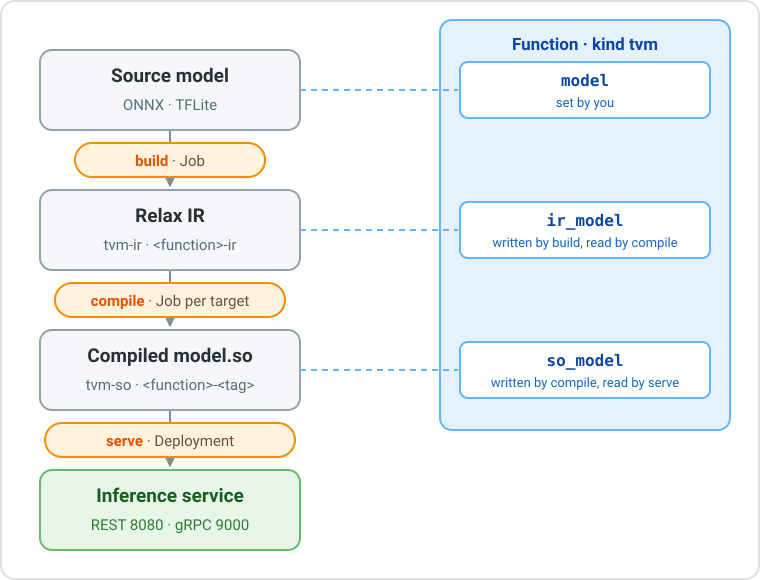

# TVM Runtime

The **TVM runtime** compiles a trained model into native code with [Apache TVM](https://tvm.apache.org/) and serves it through the [Open Inference v2](https://github.com/kserve/open-inference-protocol) protocol, over REST and gRPC.

Use an **ONNX** or **TFLite** model with the Linux CPU pipeline described here.
The toolkit compiles it; a Go or Rust runtime serves it. The same image can load
different models. Compilation alone does not guarantee faster inference: measure
the result on the intended device and use MetaSchedule when needed.



The runtime has three actions, run one after the other:

| Action | What it does | Runs as | Result |
| --- | --- | --- | --- |
| `build` | Converts the source model into Relax IR, the intermediate representation of TVM | Kubernetes Job | Model `<function>-ir`, kind `tvm-ir` |
| `compile` | Compiles the Relax IR into a native library, `model.so`, for a target architecture | Kubernetes Job | Model `<function>-<tag>`, kind `tvm-so` |
| `serve` | Deploys the compiled model as an Open Inference v2 service | Kubernetes Deployment and Service | Inference service |

## How it works

Build saves the IR reference in `function.spec.ir_model`; compile saves the compiled
Model in `function.spec.so_model`. The next action uses that reference unless its
Run supplies `model_path`. One IR can be compiled for several targets.

These updates affect the **same Function version**, not a new version. A build
leaves the previous SO usable. With concurrent compiles, the last successful
reference update wins. Running services keep their selected Model; to select a
specific build later, use a versioned `model_path`.

## From a model to a prediction

| Step | What to do | Details |
| --- | --- | --- |
| 1. Upload the model | Create a Model of kind `onnx` or `tflite` and upload the file | [Source Models](#source-models) |
| 2. Create the function | Create a function of kind `tvm` that points to the Model | [Function](#function) |
| 3. Build | Run the `build` action | [Build action](#build-action) |
| 4. Compile | Run the `compile` action for your target | [Compile action](#compile-action), [examples](#compile-examples) |
| 5. Serve | Run the `serve` action | [Serve action](#serve-action) |
| 6. Test | Send a request to the service | [Test the service](#test-the-service) |

The [TVM tutorial](../../tutorials/tvm/intro/) walks through all the steps with a YOLOv8 model, from the console and from the CLI.

### Task settings and run options

| Where | What belongs there |
| --- | --- |
| Function `spec` | Source `model`, `format`, generated `ir_model` and `so_model` references |
| Task `spec` | Function reference, `profile`, `resources`, `envs`, `secrets`, `volumes` |
| Build Run `spec` | Toolkit `image` and conversion options |
| Compile Run `spec` | `model_path`, target selection, `tag`, `image`, `optimization`, `tuning` |
| Serve Run `spec` | Model, name, image, workers, replicas and service options |

A Run can override common Task settings. TVM options are specific to each Run;
previous Runs and old Tasks do not supply their values. In the console, common
settings are in **Task**, TVM options in **Run**. A compile Run looks like this:

```yaml
kind: tvm+compile:run
spec:
  task: tvm+compile://my-project/<task-id>
  target_architecture: amd64
  tag: amd64
  optimization:
    opt_level: 3
    benchmark_runs: 10
  tuning:
    tuning_mode: "off"
  resources: {cpu: "4", mem: 8Gi}
```

With the REST API, create the Task first and use its key in `spec.task`. The run
kinds are `tvm+build:run`, `tvm+compile:run` and `tvm+serve:run`. With the SDK, pass
these options to `function.run(...)`. With `dhcli run`, pass the `spec` in a YAML file.
For scheduled/lifecycle runs, use the trigger's `spec.template`.

Flat compile parameters are also accepted. If a field is supplied both flat and
inside a group, the grouped value wins; saved specs use the grouped form.

## Source Models

Upload the model as a Model of kind `onnx` or `tflite`. The fields only describe the model and are all optional: the `build` action reads the real signature from the file.

| Kind | Fields |
| --- | --- |
| `onnx` | `inputs`, `outputs`, `parameters`, `opset` (the operator set version used at export) |
| `tflite` | `inputs`, `outputs`, `parameters` |

Each tensor in `inputs` and `outputs` has `name`, `dtype` and `shape`; quantized tensors also have `scale`, `zero_point` and `quantized_dimension`.

A Model of the generic kind `model` also works, for example one uploaded with `dhcli upload`: its format is then taken from the file extension.

---

## Function

A function of kind `tvm` describes the model to compile and serve.

| Field | Required | What to enter |
| --- | --- | --- |
| `model` | yes | The key of the source Model (`store://<project>/model/<kind>/<name>:<id>`, or without `:<id>` for the latest version), or an `s3://` or `https://` path. |
| `format` | no | `auto` (default), `onnx` or `tflite`. `auto` uses the kind of the Model, otherwise the file extension. |
| `ir_model` | no | Leave it empty: `build` fills it. |
| `so_model` | no | Leave it empty: `compile` fills it. |

```yaml
kind: tvm
name: yolo-function
spec:
  model: store://my-project/model/onnx/yolo
  format: auto
```

!!! note "When to set the format"

    `auto` works with a Model of kind `onnx` or `tflite`, and with any path ending with `.onnx` or `.tflite`. If a generic Model points to a folder or to a file without extension, set `format` to `onnx` or `tflite`.

---

## Build action

The `build` action runs a Job that converts the source model into Relax IR and saves it as the Model `<function>-ir`, of kind `tvm-ir`.

=== "ONNX"

    1. Load the ONNX model.
    2. Optionally convert it to another operator set version (`target_opset`).
    3. Optionally simplify the graph with onnxsim (`simplify`).
    4. Run the ONNX shape inference.
    5. Convert the graph into Relax IR, with `float32` as default data type.
    6. If some outputs of the IR have no shape, simplify the graph with onnxsim and convert it again (see [Outputs without a shape](#outputs-without-a-shape)).
    7. Save the IR and metadata, then publish the Model.

=== "TFLite"

    1. Load the TFLite model.
    2. Convert it into Relax IR. Full-integer quantized models are supported; dynamic-range quantized models are not.
    3. Save the IR with its `metadata.json` and publish the Model.

### Build options

All fields are optional: for most models the defaults are enough. The conversion options apply to **ONNX** models only.

| Field | Default | What it does |
| --- | --- | --- |
| `simplify` | `false` | Simplifies the graph with onnxsim before converting it. When `false`, the build still does it by itself if the converted outputs have no shape. |
| `target_opset`{: style="white-space: nowrap" } | empty | Converts the model to this ONNX operator set version first. Leave it empty unless the model needs it: the conversion fails when ONNX has no converter for an operator. |
| `opset_override`{: style="white-space: nowrap" } | model opset | Operator set version the TVM importer assumes, instead of the one declared by the model. |
| `strict_shape_inference`{: style="white-space: nowrap" } | `false` | Runs strict shape inference; a failure is logged and conversion continues without the inferred graph. |
| `data_prop` | `false` | Propagates constant values during shape inference, to resolve more shapes. |
| `keep_params_in_input`{: style="white-space: nowrap" } | `false` | Keeps the weights in a separate `params.bin`; `compile` embeds them again. |
| `sanitize_input_names`{: style="white-space: nowrap" } | `true` | Rewrites the input names into valid identifiers. |
| `image` | toolkit image | Another image for this run. |

### Outputs without a shape

TVM 0.26 converts some shape arithmetic into slices whose size is known only at run time, for example the box decoding at the end of YOLOv8. The outputs of the IR then have no shape, and `compile` cannot generate code for them.

The build handles this by itself: when `simplify` is `false` and some outputs have no shape, it simplifies the graph with onnxsim, which computes those values in advance, and converts it again. Nothing has to be set:

- the log of the build shows `some outputs have no shape: simplifying the graph with onnxsim and converting again`;
- `metadata.json` of the IR Model has `"simplify": true` and `"simplified_automatically": true`.

If onnxsim cannot simplify the graph, the build keeps the first conversion and warns that the outputs `still have no shape`: `compile` will then fail, see [Troubleshooting](#troubleshooting).

### Build output

| File | Content |
| --- | --- |
| `model.relax.json`{: style="white-space: nowrap" } | The Relax IR, read by `compile`. |
| `model.relax.ir`{: style="white-space: nowrap" } | An optional readable IR dump for debugging; compilation uses the JSON file. |
| `metadata.json`{: style="white-space: nowrap" } | Input and output tensors, source format and conversion settings. |
| `params.bin`{: style="white-space: nowrap" } | The weights, only with `keep_params_in_input: true`. |

---

## Compile action

The `compile` action runs a Job that compiles the Relax IR into `model.so` for a target architecture and saves it as the Model `<function>-<tag>` (`<function>-so` by default), of kind `tvm-so`, linked to the IR Model it comes from.

### Target CPU profiles

The console displays **Target CPU Profile**: the architecture comes first, followed by
an optional CPU feature level or board profile. `amd64` means Intel/AMD 64-bit,
`arm64` means ARM 64-bit (AArch64), and our `arm32` profile requires ARMv7 hard-float
with NEON. Armv7/Armv8/Armv9 are architecture generations, not synonyms for bitness.

| `target_architecture`{: style="white-space: nowrap" } | Where the model runs | Typical devices |
| --- | --- | --- |
| `auto` (default) | The architecture of the cluster node that runs the Job, with generic code | Nodes of the cluster |
| `amd64` | Intel/AMD 64-bit CPUs with the full x86-64-v2 feature set | Compatible servers, PCs and cluster nodes |
| `amd64_v3` | Intel/AMD 64-bit CPUs with the full x86-64-v3 feature set, including AVX2 and FMA | Compatible recent servers and PCs |
| `amd64_native` | CPU features matching the node that runs the Job | Nodes compatible with the compile node |
| `arm64` | 64-bit ARM (aarch64) | Raspberry Pi 3, 4, 5 with a 64-bit OS, NVIDIA Jetson, ARM servers |
| `arm64_pi5` | Raspberry Pi 5 (Cortex-A76, 4 cores) | Raspberry Pi 5 with a 64-bit OS |
| `arm32` | ARMv7-compatible 32-bit ARM with the hard-float ABI and NEON (armhf) | Raspberry Pi 2, 3, 4 with a 32-bit OS |

A more specific profile can improve performance, but requires compatible CPU features.
The model, OS and runtime must also agree on bitness and ABI. `auto` does not enable
native CPU optimization; `arm64_pi5` is not portable to Pi 3/4.

Legacy API values remain accepted: `cpu`/`llvm` → `auto`, `x86` → `amd64`,
`x86_v3` → `amd64_v3`, `x86_native` → `amd64_native`, `armv7l` → `arm32`.
Aliases are resolved from the configuration; stored run values are not rewritten.
The console shows the canonical profile names.
LLVM triples, compiler names and container platforms keep their standard names.

!!! note "Runtime images and CORE's init image"

    Go and Rust runtime image builds cover AMD64, ARM64 and ARMv7. ARM32 compilation
    and inference remain supported. CORE's default init image covers only AMD64 and
    ARM64, so serving on an ARM32 cluster node also requires an ARMv7-compatible init
    image to download the model. Standalone serving with a mounted model does not use it.

The compiler host and the model destination are independent:

| Toolkit host | Model destinations included in the image |
| --- | --- |
| AMD64 | AMD64, ARM64, ARM32 (ARMv7 hard-float) |
| ARM64 | AMD64, ARM64, ARM32 (ARMv7 hard-float) |

Only `amd64_native` requires an AMD64 compile node. `auto` generates generic code
for the compile node. Use the existing run profile to select a compatible toolkit
node; there is no ARM32 toolkit image.

### Configurable profiles

Platform administrators configure profiles in CORE's `runtime-tvm.yaml`. Each entry
separates its display name (`label`), standard TVM options (`target`) and C++ linker
settings (`linker`). The reader supplies the same catalogue to the compiler and
console schema; neither Java nor the SDK contains a fixed target enumeration.

Mount an override file and set `RUNTIME_TVM_CONFIG=file:/etc/digitalhub/runtime-tvm.yaml`,
then restart CORE. Entries merge with the bundled profiles:

```yaml
runtime:
  tvm:
    targets:
      arm64_pi4:
        label: Raspberry Pi 4 - ARM 64-bit (Cortex-A72)
        target:
          kind: llvm
          mtriple: aarch64-linux-gnu
          mcpu: cortex-a72
          mattr: [+neon]
          num-cores: 4
        linker:
          command: aarch64-linux-gnu-g++
          options: []
```

The new profile is selected as `target_architecture: arm64_pi4`. `target` contains
standard TVM keys: `mtriple` identifies the architecture/OS/ABI, `mcpu` selects the
CPU, `mattr` lists instruction features and `num-cores` sets the target core count used for scheduling.
Spring reads the YAML once; CORE converts each target mapping to a JSON value,
preserving lists and numbers. The compiler and console use the same catalogue.

`linker.command` is the C++ compiler used to link `model.so`; `linker.options` is a
list of separate arguments, such as `["--sysroot=/opt/sysroots/arm64"]`. Optional profile
fields are `aliases` (unique lowercase alternative names) and `compiler-architecture` (a Kubernetes
architecture constraint for the compile node, needed by `amd64_native`). The separate
Run `profile` chooses where the Job executes; it does not select the model's target.

`optimization.target_num_cores` overrides the Job CPU request; either one overrides
`target.num-cores`. If neither is set, the value in the target remains, including
with `mcpu: native`; native detection supplies a core count only when it is absent.
Use an explicit core count when tuning for a device with different resources.

Run options keep their names: `optimization.cross_cc` overrides `linker.command`,
and `optimization.cross_cc_options` overrides `linker.options`.
For compiler arguments, choose **Profile defaults** to inherit the YAML configuration,
or **Custom arguments** to replace it. An explicit empty list clears those defaults.

An override file keeps omitted profiles and fields. Supplying `target` replaces its
whole definition rather than inheriting potentially incompatible CPU features.
To migrate an old override file, expand the quoted JSON target into a YAML mapping
and move `cross-cc` / `cross-cc-options` under `linker.command` / `linker.options`.
Old forms are rejected with a configuration error. SDK requests and model metadata
are unchanged.

### Explicit target for one run

For an advanced, one-off configuration, omit `target_architecture` or leave it at
`auto`, then provide a standard TVM LLVM target:

```yaml
target:
  kind: llvm
  mtriple: aarch64-linux-gnu
  mcpu: cortex-a72
optimization:
  cross_cc: aarch64-linux-gnu-g++
  cross_cc_options: []
```

Do not combine an explicit target with a non-auto profile. An explicit target
does not inherit a preset's linker settings. `cross_cc_options` passes
arguments separately; for example `["--sysroot=/opt/sysroots/arm64"]` uses target
libraries at that path **inside the compile container**.

The compiler links a small LLVM object before processing the model, so a missing
or incompatible toolchain fails early. Another CPU family may require a custom
`image` with its LLVM backend, compiler and target libraries. Configuring its name
does not add a runtime image. This integration remains Linux/CPU; Jetson Orin CUDA
needs a separate GPU integration.

### Compile options

All fields are optional. These fields are directly inside the Run `spec`:

| Field | Type | Default | Purpose |
| --- | --- | --- | --- |
| `model_path` | string | Function `ir_model` | IR Model to compile; an explicit reference always wins. |
| `target_architecture` | string | `auto` | Name from the configured CPU catalogue. |
| `target` | object | unset | Standard LLVM target instead of a non-auto preset. |
| `tag` | string | `so` | Model name suffix: `<function>-<tag>`. Use a different tag for each target if useful. |
| `image` | string | Toolkit image | Image used by this compile Job. |

The following fields go inside `optimization` (**Advanced compilation**):

| Field | Type | Default | Purpose |
| --- | --- | --- | --- |
| `target_num_cores` | integer ≥ 1 | Job CPU request, rounded up | Cores used to optimize the generated code; see the precedence above. |
| `opt_level` | integer 0–3 | `3` | TVM pass optimization level. |
| `exec_mode` | string | `bytecode` | Relax VM graph execution: `bytecode` or `compiled`. Both use compiled operators. |
| `cross_cc` | string | Preset linker, otherwise native compiler | C++ compiler linking `model.so`; e.g. `aarch64-linux-gnu-g++`. |
| `cross_cc_options` | list of strings | Preset arguments, normally `[]` | Separate linker arguments. Explicit `[]` clears the preset arguments. |
| `relax_pipeline` | string | `default` | Installed Relax pipeline name. |
| `tir_pipeline` | string | `default` | Installed TIR pipeline name. |
| `system_lib` | boolean | `false` | Advanced system-library mode; the Go/Rust serve images cannot load it. |
| `params_path` | string | IR `params.bin` | Optional weights file path inside the Job. |
| `benchmark_runs` | integer ≥ 0 | `10` | Timed CPU inferences on the compile host; `0` disables them. |

These optimization settings still apply when MetaSchedule is off. Tuning fields
belong to the separate [tuning group](#tuning-options).

### Compile examples

In the console, choose **compile → CREATE** and set the target in the Run step.
With the CLI, save this as `compile.yaml`:

```yaml
spec:
  target_architecture: amd64
  tag: amd64
  optimization:
    opt_level: 3
  resources: {cpu: "4", mem: 8Gi}
```

```sh
dhcli run tvm+compile -p my-project -n yolo-function -f compile.yaml
```

Change `target_architecture` and `tag` to `arm64` or `arm32` to compile the same IR
for those devices. The preset supplies the linker. For a specific IR version, add
`model_path: store://my-project/model/tvm-ir/yolo-function-ir:<id>` to the Run.

Each successful compile updates `so_model`. After an ARM compile, a new serve uses
that ARM Model. To serve an earlier AMD64 build, set serve `model_path` to its
versioned `tvm-so` key. An existing service is not changed.

### Compile output

| File | Content |
| --- | --- |
| `model.so` | The compiled model. |
| `metadata.json`{: style="white-space: nowrap" } | The IR metadata plus how the library was built: `target`, optional `target_requested`, `target_triple`, `tvm_version`, `tvm_git_commit`, `opt_level`, `exec_mode`, `relax_pipeline`, `tir_pipeline`, `tag`, and the `benchmark` and `meta_schedule` sections when present. |
| `tuning/` | The tuning database, only for tuned models. |

The metadata fields describe different stages:

| Field | Meaning |
| --- | --- |
| `target` | Effective TVM target used to compile, with the resolved triple, CPU and core count. |
| `target_requested` | Original target passed to the compiler, saved when different from `target`; useful for diagnosing `auto` or `mcpu: native`. Not a Run option. |
| `target_triple` | Architecture, OS and ABI, e.g. `aarch64-linux-gnu`; CORE uses it to select a serving architecture. |

The Run's `target` is an input object; the Model's `target` is the resolved target
serialized as a string. The Go/Rust runtime consumes the Model metadata, not the
preset name or CORE's YAML file.

`toolchain` records the compiler executable, its argument list and the compiler
host triple. These identify how the library was linked; they do not change where
the compiled model can run.

---

## Model Optimization

Untuned CPU code can be slower than ONNX Runtime. **MetaSchedule** measures candidate
schedules on the target hardware and applies the best valid records it finds.
The result depends on the model, hardware, thread count and search budget; compare
measured inference times before assuming an improvement.

| Mode | Active settings | Result |
| --- | --- | --- |
| `off` (default) | No tuning fields | Ordinary compilation; other tuning values are retained but ignored before validation. |
| `tune` | Database/coverage, search and measurement settings | Measures candidates and saves the database in the compiled Model's `tuning/` folder. |
| `apply` | `tuning_model_path`, `tuning_ops`, `allow_partial_tuning` | Uses a selected database without running a search. |

The form hides inactive fields and supplies typed defaults when tuning is enabled.
The total `tuning_trials` budget remains your choice. A later Run never discovers a
database automatically: set `tuning_model_path` to reuse or continue one.

### Tune once

Tune on hardware compatible with the serving CPU. Set resources in **Task**, then
the target, **Advanced compilation** and **MetaSchedule tuning** in **Run**:

```yaml
spec:
  target_architecture: amd64_native
  tag: tuned
  resources:
    cpu: '4'
    mem: 8Gi
  optimization:
    target_num_cores: 4
  tuning:
    tuning_mode: tune
    tuning_trials: 8000
    max_trials_per_task: 256
```

Result: the Model `<function>-tuned`, whose `tuning/` folder holds the database. Its key, shown in the detail page of the Model, is what the next compiles need, for example `store://my-project/model/tvm-so/yolo-function-tuned:<id>`.

### Reuse a tuning

Set `tuning_mode: apply` and the versioned key of the tuned Model. Keep the same
effective target and core count:

```yaml
spec:
  target_architecture: amd64_native
  tag: fast
  optimization:
    target_num_cores: 4
  tuning:
    tuning_mode: apply
    tuning_model_path: store://my-project/model/tvm-so/yolo-function-tuned:<id>
```

The Job downloads and validates that Model's `tuning/` folder, then applies its records without new measurements. The `meta_schedule` section of the new `metadata.json` shows `"mode": "apply"` and `"database_reused": true`. The new Model has its own copy of `tuning/`, so it can be reused in turn.

A tuning can be reused only when these match:

| Must match | Why it matters |
| --- | --- |
| TVM version and commit | Use the toolkit image of the same release, e.g. `tvm-toolkit:0.26.0`. |
| Target | Same effective target, including CPU features **and** `target_num_cores`. When `target_num_cores` is empty it comes from `resources.cpu`: changing the CPUs of the run makes the database incompatible. With `amd64_native` the CPU model of the node counts too. |
| IR | Matching source/IR identity; changing the model or conversion can invalidate the database. |
| Coverage | All selected tunable functions need valid records unless `allow_partial_tuning` is `true`. Unselected operations keep default schedules. |

When something does not match, the run stops in **ERROR** with `incompatible MetaSchedule database` and the list of differences, or with `does not cover every selected function`.

### Continue a tuning

To add more measurements to an existing database, run `compile` with `tuning_mode: tune`, the key of the tuned Model in `tuning_model_path` and a `tuning_trials` budget for the search. The search restarts from the variants already measured.

### Tuning options

All these fields go inside `tuning`. Counts are integers; timeouts are seconds.

| Field | Default | What it does |
| --- | --- | --- |
| `tuning_mode` | `off` | `off`, `tune` (search the fastest code) or `apply` (reuse an earlier search). |
| `tuning_trials` | empty | Total number of variants to measure. **Required** with `tune`. |
| `max_trials_per_task`{: style="white-space: nowrap" } | `16` | Maximum variants per extracted tuning task (which can contain fused operators). |
| `tuning_trials_per_iter`{: style="white-space: nowrap" } | `64` | Variants measured for each task in one round. |
| `tuning_ops` | all | List of task-name filters, e.g. `[conv2d]`; applies to both `tune` and `apply`. |
| `tuning_model_path`{: style="white-space: nowrap" } | empty | An earlier compiled Model: `tune` continues its search, `apply` uses it. **Required** with `apply`. |
| `tuning_workers` | `resources.cpu` | Parallel candidate builds; with RPC, also the maximum parallel device connections. |
| `tuning_seed` | `0` | Random seed, for repeatable searches. |
| `tuning_number` | `3` | Runs averaged in one measurement. |
| `tuning_repeat` | `1` | Measurements taken for each variant. |
| `tuning_min_repeat_ms`{: style="white-space: nowrap" } | `100` | Minimum length of one measurement, in milliseconds. |
| `tuning_alloc_repeat`{: style="white-space: nowrap" } | `1` | Input buffers rotated between measurements, to reduce cache effects. |
| `tuning_enable_cpu_cache_flush`{: style="white-space: nowrap" } | `false` | Flushes the CPU caches before each measurement. |
| `tuning_builder_timeout_sec`{: style="white-space: nowrap" } | `30` | Time limit to compile one variant. |
| `tuning_runner_timeout_sec`{: style="white-space: nowrap" } | `30` | Local runner timeout; ignored with RPC, which uses its session timeout. |
| `allow_partial_tuning`{: style="white-space: nowrap" } | `false` | Allows incomplete optimization for intentional partial searches; it still requires usable records. |

Failed candidates are counted in `tuning/errors.json`, which also records the first
error returned by TVM. The Job log shows that cause directly. On a busy node, set
larger builder/runner timeouts explicitly. Compilation stops before publication
when the database has no valid records.

### Tuning on a device

For a target that cannot execute on the compile node, register a compatible device
with a TVM RPC tracker and use `tuning_runner: rpc`. The device needs the matching
TVM runtime and libraries. Alternatively, use `apply` with a compatible database.
These fields also belong inside `tuning`:

| Field | Default | What it does |
| --- | --- | --- |
| `tuning_runner` | `local` | `local` measures in the compile Job, `rpc` on a device registered with the tracker. |
| `rpc_tracker_host`{: style="white-space: nowrap" } | empty | Host of the TVM RPC tracker. **Required** with `rpc`. |
| `rpc_tracker_port`{: style="white-space: nowrap" } | empty | Port of the TVM RPC tracker. **Required** with `rpc`. |
| `rpc_tracker_key`{: style="white-space: nowrap" } | empty | Key the device is registered with. **Required** with `rpc`. |
| `rpc_session_timeout_sec`{: style="white-space: nowrap" } | `60` | Time limit of one RPC session. |

Local tuning ignores RPC fields. CORE rejects missing tuning budgets/databases,
`tuning_workers` above the Job CPU allocation, and local target cores above that
allocation. The compile Job checks the actual
host architecture, ABI and CPU instructions detectable by LLVM before local
measurements; this is not an exhaustive CPU compatibility certification. ARM targets can
be tuned locally on compatible ARM nodes; using `cross_cc` is not itself a reason
to reject local tuning or skip a benchmark. Otherwise use RPC or apply a matching
database. RPC receives candidates linked with the same compiler/options as the
final model.

### Budget and measurements

- The first-round budget is `selected tasks × min(tuning_trials_per_iter, max_trials_per_task)`.
  The log reports it. The default cap of 16 trials per task is small; increase it
  together with the total budget for a wider search.
- Use the same target and threads per worker when tuning, benchmarking and serving.
- `benchmark_runs` measures TVM in a subprocess on the **compile host**: synthetic
  inputs are allocated first, up to five warm-ups run, then the configured number
  of VM calls are timed. Metadata records `mean_ms`, `p50_ms`, `p90_ms`, `min_ms`,
  thread count and sample count. It excludes image preparation, HTTP and model loading.
- An incompatible host, unsupported CPU instructions or a failed benchmark can
  produce `benchmark.skipped`; that is not an inference result on the target device.
  This built-in benchmark does not compare against ONNX Runtime.

## Serve action

The `serve` action deploys the compiled Model. An init container downloads `model.so` and `metadata.json` into the pod; the serve image loads them and exposes the model on port `8080` (REST) and `9000` (gRPC).

### Serve options

All fields are optional.

| Field | Default | What it does |
| --- | --- | --- |
| `model_path`{: style="white-space: nowrap" } | function `so_model` | Key of the compiled Model to serve. |
| `served_name`{: style="white-space: nowrap" } | function name | Name of the model in the API, `/v2/models/<served_name>`. Letters, digits, `.`, `_` and `-`, starting and ending with a letter or digit. |
| `replicas` | `1` | Number of pods, zero or greater. |
| `workers` | `1` | Requests handled in parallel by each pod; each worker loads its own copy of the model. |
| `service_type`{: style="white-space: nowrap" } | `ClusterIP` | Kubernetes Service type: `ClusterIP`, `NodePort` or `LoadBalancer`. |
| `service_name`{: style="white-space: nowrap" } | empty | Extra Service name, `<function>-<service_name>`. |
| `image` | platform serve image (Go by default) | Custom serve image for this run, overriding `RUNTIME_TVM_SERVE`. See [Serving runtimes](#serving-runtimes). |

```yaml
spec:
  workers: 1
  resources:
    cpu: "2"
    mem: 2Gi
```

When the Run requests CPUs, CORE derives the thread count from CPUs divided by workers (at least one thread). To choose the number yourself, add `TVM_NUM_THREADS` to `envs`.

When the Run is **RUNNING**, `status.service` reports the platform address.
`status.inference_v2` contains `baseUrl`, `model`, `inferenceUrl`, `modelMetadataUrl`,
`modelReadinessUrl`, `readinessUrl` and `livenessUrl` for the console client.
`served_name` defaults to the Function name; `service_name` does not rename the model.
Use REST port `8080`, not gRPC port `9000`.

An explicit `model_path` wins over the Function reference. The selected key is
saved in the Run; clear it when copying a Run if the new service should use the
Function's current `so_model`.

### Where the service runs

A `model.so` runs only on the CPU architecture it was compiled for. The platform reads the architecture from the compiled Model and starts the service only on the nodes of the same architecture (the node label `kubernetes.io/arch`):

| Compiled for | Nodes of the service |
| --- | --- |
| `amd64`, `amd64_v3`, `amd64_native`, `auto` on an AMD64 node | `amd64` |
| `arm64`, `arm64_pi5`, `auto` on an ARM64 node | `arm64` |
| `arm32` | `arm` (ARMv7, hard-float, NEON) |

Go and Rust runtime image builds include all three architectures. Each node downloads
its image variant. An ARM64 model can be served inside the platform when the cluster
has ARM64 nodes, for example a Raspberry Pi running a 64-bit OS and joined to the cluster.
ARM32 nodes also need an ARMv7-compatible init image: CORE's default init image covers
only AMD64 and ARM64. Matching the architecture does not replace CPU-feature and ABI
compatibility checks; for example, an `arm64_pi5` model needs a compatible Cortex-A76 CPU.

!!! warning "No node of the right architecture"

    If the cluster has no node of the model architecture, the service stays **PENDING**. Choose a compatible node/profile or serve a Model compiled for the available nodes.

A `profile` that sets its own node selector takes precedence over this choice.

### Endpoints

| What | REST | gRPC |
| --- | --- | --- |
| Server live | `GET /v2/health/live` | `ServerLive` |
| Server ready | `GET /v2/health/ready` | `ServerReady` |
| Server metadata | `GET /v2` | `ServerMetadata` |
| Model ready | `GET /v2/models/<name>/ready` | `ModelReady` |
| Model metadata | `GET /v2/models/<name>` | `ModelMetadata` |
| Inference | `POST /v2/models/<name>/infer` | `ModelInfer` |

The gRPC API is the `inference.GRPCInferenceService` of the [KServe v2 protocol](https://github.com/kserve/open-inference-protocol).

Read `/v2/models/<name>` first, then send exactly the advertised input names,
datatypes, shapes and number of values. For a model exposing `x: FP32 [1,4]`, this
is a complete inference request (it is **not** a YOLO input):

```json
{
  "inputs": [
    {"name": "x", "datatype": "FP32", "shape": [1, 4], "data": [1.0, 2.0, 3.0, 4.0]}
  ]
}
```

The response lists output tensors with their name, datatype, shape and data.
For quantized `INT8`/`UINT8` tensors, REST metadata includes `parameters.scale`,
`parameters.zero_point` and, when present, `parameters.quantized_dimension`.
Recover real values with `real = (quantized - zero_point) * scale`; per-axis values
apply along `quantized_dimension` (zero when omitted).

Health success is HTTP `200`; clients should not require a JSON body, which differs
between the Go and Rust servers. A metadata request is a convenient check through
the CORE proxy.

Rules for the requests:

- `data` holds the values in row-major order, flat or nested.
- Inputs are matched by name when every input has a name that matches the model; otherwise by position.
- Supported data types: `FP32`, `FP64`, `INT8`, `INT16`, `INT32`, `INT64`, `UINT8`, `UINT16`, `UINT32`, `UINT64`. `FP16` is not supported.

---

## Test the service

The default `ClusterIP` service is internal to the cluster. There are three ways to
test it; NodePort/LoadBalancer access depends on the platform network configuration.

=== "From your computer"

    The [CLI](../components/cli.md) (version 0.15 or later) opens an authenticated port-forward to the service. It carries REST requests only.

    ```sh
    dhcli login
    dhcli services -p my-project
    dhcli port-forward -p my-project -f yolo-function -l 18080
    ```

    In another terminal:

    ```sh
    curl http://localhost:18080/v2/models/yolo-function
    ```

=== "Locally with Docker"

    Download the compiled Model and run the same serve image on your computer. REST and gRPC both work.

    ```sh
    dhcli download model -p my-project -n yolo-function-amd64 -d ./yolo-model

    docker run --rm -p 8080:8080 -p 9000:9000 \
      -v "$PWD/yolo-model:/shared/model" \
      -e TVM_MODEL_NAME=yolo-function \
      ghcr.io/scc-digitalhub/tvm-runtime-go:0.26.0
    ```

    In another terminal:

    ```sh
    curl http://localhost:8080/v2/models/yolo-function
    ```

    The model must be compiled for the architecture of your computer (`amd64` or `auto` on a compatible Intel/AMD 64-bit PC).

=== "On an ARM device"

    Use a device with Docker and either a 64-bit ARM OS or an ARMv7 hard-float 32-bit OS with NEON. Download the matching Model and start the image there. For a 64-bit OS:

    ```sh
    dhcli download model -p my-project -n yolo-function-arm64 -d ./yolo-model

    docker run --rm -p 8080:8080 -p 9000:9000 \
      -v "$PWD/yolo-model:/shared/model" \
      -e TVM_MODEL_NAME=yolo-function \
      ghcr.io/scc-digitalhub/tvm-runtime-go:0.26.0
    ```

    For a 32-bit OS, download `yolo-function-arm32` instead. For a 64-bit OS, use `arm64` (or `arm64_pi5` on Pi 5). Docker picks the image variant of the device automatically. This standalone example does not use CORE's init image.

The [tutorial](../../tutorials/tvm/test/) includes a standalone Python client for a
real picture. It does not depend on private or locally ignored test scripts.

## Common run options

Every action accepts the standard options of the platform: `resources`, `envs`, `secrets`, `volumes` and `profile` (see [Kubernetes resources](../tasks/kubernetes-resources.md)). Starting values for small models (adjust to the model and available resources):

| Action | CPU | Memory | Notes |
| --- | --- | --- | --- |
| `build` | 2–4 | 4–8 Gi | Grows with the model size. |
| `compile` | 4 | 8 Gi | Starting point for small models; tuning and larger models can need more memory. |
| `serve` | 1–4 | 1–2 Gi | The CPUs are split among the `workers`. |

`resources.disk` sets the working volume size (default `4Gi`). `profile` chooses
platform scheduling/resources, not the model target. A profile node selector takes
precedence over the runtime selector; choose compatible compiler and serving nodes.
`inputs` records consumed entity keys; it does not contain inference tensor data.

---

## Inside the Jobs

The `build` and `compile` Jobs run the `tvm-toolkit` image, which contains only the tools: Apache TVM, LLVM, the native/cross compilers and the ONNX and TFLite importers. The scripts that do the work are part of the runtime: the platform mounts them into each Job, so a new version of the platform updates them without a new image.

| Script | Role |
| --- | --- |
| `entrypoint.sh` | Prepares the working folders and starts the script of the action. |
| `build_onnx.py`, `build_tflite.py` | Convert the source model into Relax IR (`build`). |
| `compile_model.py` | Compiles the IR into `model.so` (`compile`). |
| `tuning.py`, `benchmark.py` | MetaSchedule tuning and the timing of the library, used by `compile_model.py`. |
| `publish.py` | Uploads the result as a Model of kind `tvm-ir` or `tvm-so` and records it in the run. |
| `common.py` | Helpers shared by the other scripts. |

The platform chooses the script from the action and the source format, and passes every option of the run as an environment variable (`TVM_TARGET`, `TVM_OPT_LEVEL`, ...). When the script ends, the platform copies the key of the published Model into the function field `ir_model` or `so_model`.

Publication uses direct HTTP calls to Core, not the DigitalHub SDK. Core supplies
signed upload URLs and the storage path. The scripts upload the artifacts, including
large files through multipart uploads, register the Model and verify the run output.
The `DHCORE_*` credentials are used only for Core and are not forwarded to storage.

---

## Serving runtimes

The `serve` action can use two images. They read the same model folder, expose the same endpoints on the same ports and accept the same requests. Go is the platform default; use the `image` field to choose another serve image for a single run:

```yaml
spec:
  image: ghcr.io/scc-digitalhub/tvm-runtime-rust:0.26.0
```

Each image is multi-arch: the same tag serves `amd64`, `arm64` and `arm/v7` nodes, and each node downloads its own variant. There is no image to choose per architecture.

| | Go (default) | Rust |
| --- | --- | --- |
| Image | `ghcr.io/scc-digitalhub/tvm-runtime-go:0.26.0` | `ghcr.io/scc-digitalhub/tvm-runtime-rust:0.26.0` |
| Server | Nuclio processor with a native `tvm` runtime | Standalone `tvm-serve` server |
| How it calls TVM | Go, through cgo and the TVM C API | Rust, through the TVM C API |
| Parallel requests | One Nuclio worker per `workers`, each with its own model copy | One thread per `workers`, each with its own model copy |
| Maximum REST request | 512 MiB | 1 GiB |
| Maximum gRPC message | 512 MiB | 512 MiB |
| Maximum output tensors | 64 | No equivalent fixed limit |
| Extra response field | — | `parameters.inference_time_ms` |
| Platforms | `linux/amd64`, `linux/arm64`, `linux/arm/v7` | `linux/amd64`, `linux/arm64`, `linux/arm/v7` |

Neither image contains Python. Each serves one Model, without automatic request
batching. Clients handle preprocessing and output decoding. Both use these environment variables:

| Variable | Default | Description |
| --- | --- | --- |
| `TVM_MODEL_DIR`{: style="white-space: nowrap" } | `/shared/model` | Folder with `model.so` and `metadata.json`. Set by the platform. |
| `TVM_MODEL_NAME`{: style="white-space: nowrap" } | `model` | Model name in the API. Set from `served_name`, otherwise the Function name. |
| `TVM_SERVE_WORKERS`{: style="white-space: nowrap" } | `1` | Parallel workers. Set by the platform from `workers`. |
| `TVM_NUM_THREADS`{: style="white-space: nowrap" } | every core | Threads used by TVM for each worker. Set by the platform from `resources.cpu / workers`, unless `envs` sets it. |
| `TVM_SERVE_PORT`{: style="white-space: nowrap" } | `8080` | REST port. |
| `TVM_SERVE_GRPC_PORT`{: style="white-space: nowrap" } | `9000` | gRPC port. |

At startup, both images refuse a model, with a clear error, when it was compiled with another TVM release or for another CPU architecture, or when it uses an unsupported data type.

!!! note "Use images of the same release"

    Compile and serve with images of the same release, such as `tvm-toolkit:0.26.0` and `tvm-runtime-go:0.26.0`: the serve images check that `model.so` was built with their own TVM version and commit. Recompile the models after upgrading the images.

---

## Models produced

The `build` and `compile` actions publish Models named `<function>-ir` (kind `tvm-ir`) and `<function>-<tag>` (kind `tvm-so`). The framework is `tvm`, the algorithm `tvm-relax-ir` or `tvm-compiled-so`, and the specification contains:

| Field | Description |
| --- | --- |
| `entry` | Function of the model to call, usually `main`. |
| `inputs`, `outputs` | Tensors, with `name`, `dtype`, `shape` and, when quantized, `scale`, `zero_point` and `quantized_dimension`. |
| `source_format`, `keep_params_in_input`, `sanitize_input_names` | How the IR was built (`tvm-ir`). |
| `target`, `opt_level`, `manifest` | How the library was compiled, and its full `metadata.json` (`tvm-so`). |

---

## Platform configuration

Administrators choose the images with these environment variables of the Core:

| Variable | Default | Description |
| --- | --- | --- |
| `RUNTIME_TVM_CONFIG` | bundled YAML only | Optional external YAML location, e.g. `file:/etc/digitalhub/runtime-tvm.yaml`; restart CORE after changing it. |
| `RUNTIME_TVM_BUILDER_ONNX`{: style="white-space: nowrap" } | `ghcr.io/scc-digitalhub/tvm-toolkit:0.26.0` | Image of `build` for ONNX models. |
| `RUNTIME_TVM_BUILDER_TFLITE`{: style="white-space: nowrap" } | `ghcr.io/scc-digitalhub/tvm-toolkit:0.26.0` | Image of `build` for TFLite models. |
| `RUNTIME_TVM_COMPILER`{: style="white-space: nowrap" } | `ghcr.io/scc-digitalhub/tvm-toolkit:0.26.0` | Image of `compile`. |
| `RUNTIME_TVM_SERVE`{: style="white-space: nowrap" } | `ghcr.io/scc-digitalhub/tvm-runtime-go:0.26.0` | Default image of `serve`, overridden by the run's `image` field. |
| `RUNTIME_TVM_HOME_DIR`{: style="white-space: nowrap" } | `/shared` | Working folder inside the pods. |
| `RUNTIME_TVM_VOLUME_SIZE`{: style="white-space: nowrap" } | `4Gi` | Default size of the working volume. |
| `RUNTIME_TVM_USER_ID`, `RUNTIME_TVM_GROUP_ID` | platform user and group | User and group the pods run as. |

To use Rust as the platform default, set `RUNTIME_TVM_SERVE=ghcr.io/scc-digitalhub/tvm-runtime-rust:0.26.0` on Core. A single run can still select another image with `image`.

A custom image must support the architecture of the nodes on which the model is served. A multi-arch image allows the same tag to be used across different architectures.

---

## Troubleshooting

| Problem | Cause and solution |
| --- | --- |
| The compile Job is killed (`OOMKilled`, exit code 137) | Inspect the pod termination reason. For `OOMKilled`, increase memory or reduce tuning workers; CPU allocation alone does not fix it. |
| Build error `No Adapter From Version <n> for <operator>` | `target_opset` asks for a conversion ONNX cannot do: leave `target_opset` empty, or choose a version supported by all the operators. |
| Build error `cannot detect the TVM source format` | The Model is of kind `model` and its path has no `.onnx` or `.tflite` extension: use a Model of kind `onnx` or `tflite`, or set `format` in the function. |
| Compile error `CodeGenVM cannot handle this intrinsic now` | The IR has outputs without a shape and onnxsim could not fix them: the build log shows `still have no shape`. Build with `simplify: true` to see the onnxsim error, or export the model again with fixed shapes. See [Outputs without a shape](#outputs-without-a-shape). |
| `model.relax.json not found` | Check the Run's explicit `model_path` and the IR Model files; clear the override to use `function.ir_model`. |
| `tvm+compile needs an IR model`{: style="white-space: nowrap" } | Run `build` first, or set `model_path` to an IR Model. |
| `tvm+serve needs a compiled .so model`{: style="white-space: nowrap" } | Run `compile` first, or set `model_path` to a compiled Model. |
| The compile run goes to **ERROR** at once, with a message about tuning | The tuning options do not fit together, for example `tune` without `tuning_trials`: see [Tuning options](#tuning-options). |
| The compile or serve run stays **PENDING** | No node of the cluster has the architecture the run needs: see [Where the service runs](#where-the-service-runs). Check the profile/node selector, available nodes and pod events before choosing another target or Model. |
| The serve pod restarts right after starting | The log explains why: the model was compiled with another TVM release, with `system_lib`, or uses an unsupported data type. Recompile it with the toolkit of the same release. |
| `404` on `/v2/models/<name>` | The name is not the `served_name` of the run (by default, the function name). |
| The endpoint cannot be reached from your computer | The default service is internal: use `dhcli port-forward`, or a platform-approved external route. |

---

## Source code

Each component has a README with more details:

| Component | What it contains |
| --- | --- |
| [runtime-tvm](https://github.com/scc-digitalhub/digitalhub-core/tree/main/runtimes/runtime-tvm) | The runtime in the Core: actions, options and the scripts run by the Jobs. |
| [digitalhub-tvm-toolkit](https://github.com/scc-digitalhub/digitalhub-tvm-toolkit) | The image of `build` and `compile`: Apache TVM, LLVM, ARM compilers, ONNX and TFLite importers. |
| [Go serve runtime](https://github.com/scc-digitalhub/digitalhub-serverless/blob/serverless-tvm/pkg/processor/runtime/tvm/README.md) | The default serve image, in `digitalhub-serverless`. |
| [digitalhub-tvm-rust](https://github.com/scc-digitalhub/digitalhub-tvm-rust) | The Rust serve image. |

## Management with SDK

Check the [SDK TVM runtime documentation](https://scc-digitalhub.github.io/docs/0.16/sdk/reference/runtimes/tvm/overview/) for more information.

## See Also

- [Tutorial: compile and serve an ONNX model with TVM](../../tutorials/tvm/intro/)
- [Serving Machine Learning Models](../ml-tasks/serving-ml-models.md)
- [Invoke, use, and expose services](../tasks/services.md)
- [CLI](../components/cli.md)
